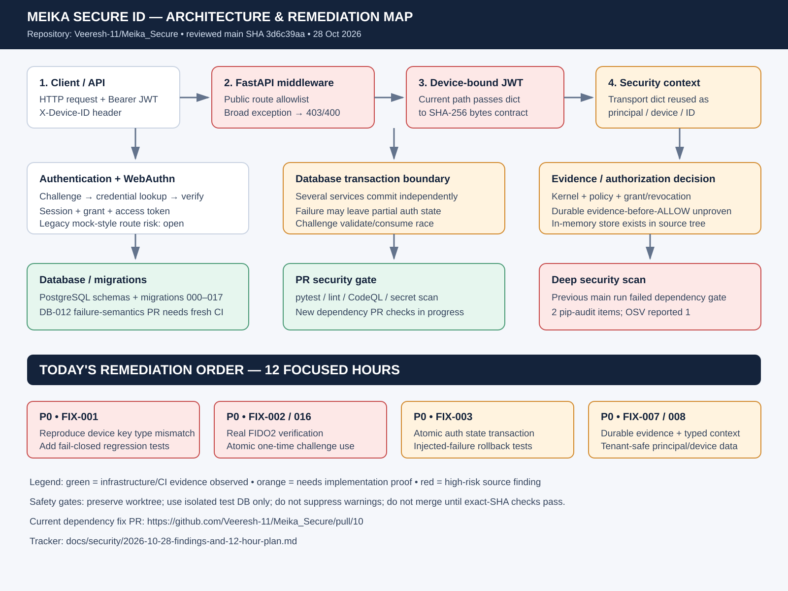

# Meika Secure ID architecture map

This map is a static architecture/source-review aid, not a live runtime trace. The red/orange items remain findings until a fix passes tests and CI on the exact candidate commit.

- [Security findings tracker and 12-hour work plan](../security/2026-10-28-findings-and-12-hour-plan.md)
- [Dependency audit remediation PR #10](https://github.com/Veeresh-11/Meika_Secure/pull/10)
- [Main branch](https://github.com/Veeresh-11/Meika_Secure/tree/main)
